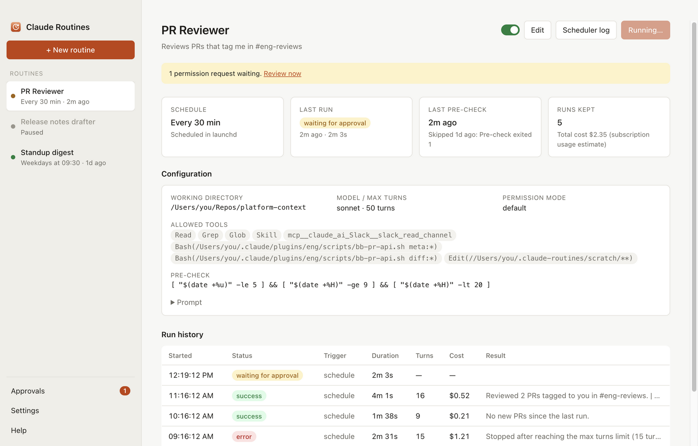
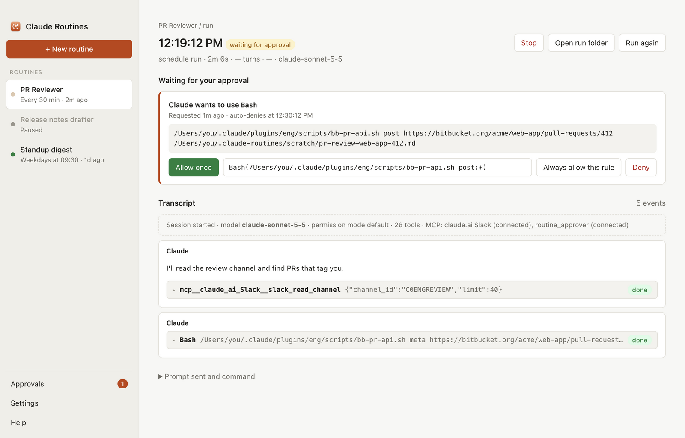
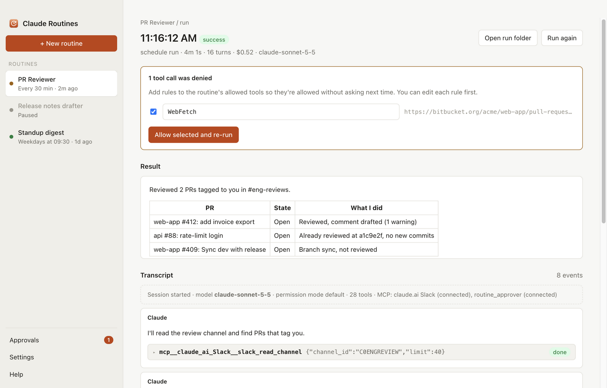
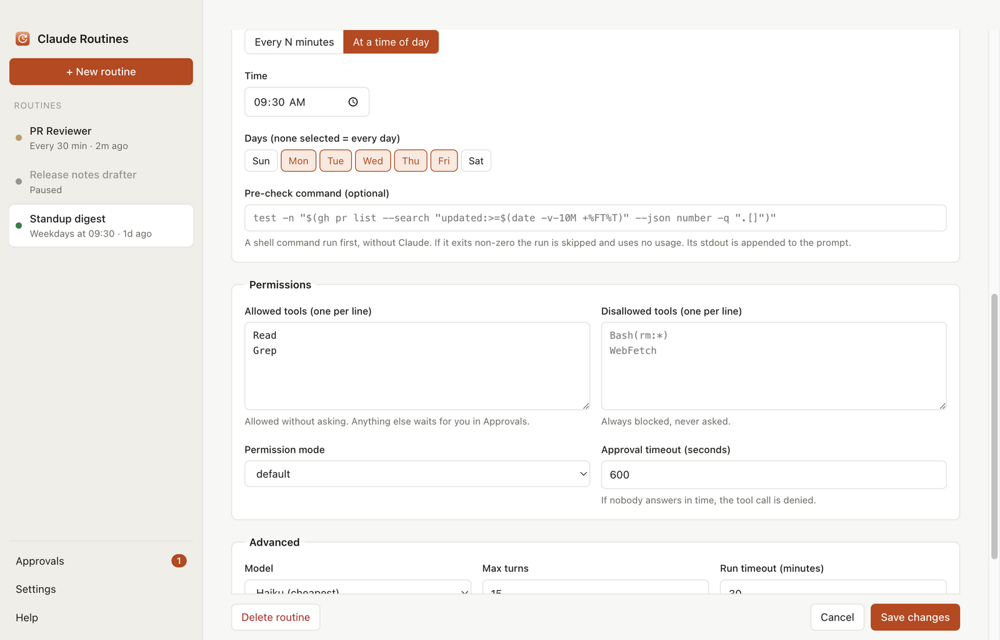
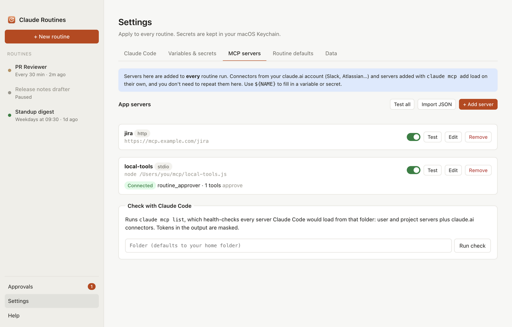

# Claude Routines

A macOS app that runs Claude Code prompts and skills on a schedule using your Claude subscription. It keeps a full transcript of every run and asks you before Claude uses any tool you haven't allowed.



The complete guide is built into the app: click **Help** in the sidebar. Its source is [src/renderer/help/help.md](src/renderer/help/help.md).

## Install

1. Install Claude Code and sign in: `npm install -g @anthropic-ai/claude-code`, then `claude` and `/login`.
2. Open the `.dmg` and drag **Claude Routines** to Applications.
3. Open it. The build isn't signed, so the first time go to **System Settings → Privacy & Security → Open Anyway**.
4. Check **Settings → Claude Code** shows *Installed* and *Signed in: Yes*.

Requires a Mac with Apple Silicon.

## What it does

| | |
|---|---|
|  | **Approvals.** Tools that aren't allowed pause the run and ask you, with a macOS notification. Allow once, always allow (saved as a rule), or deny. |
|  | **Run history.** The result, every tool call, denied calls with one-click *Allow and re-run*, and a plain-words reason when a run fails. |
|  | **Schedules.** Every N minutes or at set times. A shell **pre-check** skips runs that have nothing to do, using none of your usage. |
|  | **Settings.** Variables, Keychain-backed secrets, MCP servers with connection tests, and defaults for new routines. |

## Develop

```bash
npm install
npm start          # run from source
npm run dist       # build dist/Claude Routines-<version>-arm64.dmg and .zip
```

- `src/main.js`: Electron main process and IPC
- `src/runner.js`: runs one routine (lock → pre-check → `claude -p`). launchd starts it in Node mode.
- `src/approver-mcp.js`: the MCP server behind `--permission-prompt-tool`, which turns tool requests into approvals
- `src/lib/`: storage, launchd, Keychain secrets, run environment, MCP tester
- `src/renderer/`: UI (`app.js`, `settings.js`, `help.js`) and the guide in `help/`

Only one copy of the app should be in use. The copy opened last points the schedules at itself, so after `npm start`, open the installed app again to point them back.

To refresh the guide's screenshots, recapture them from sample data and save them to `src/renderer/help/img/`.
